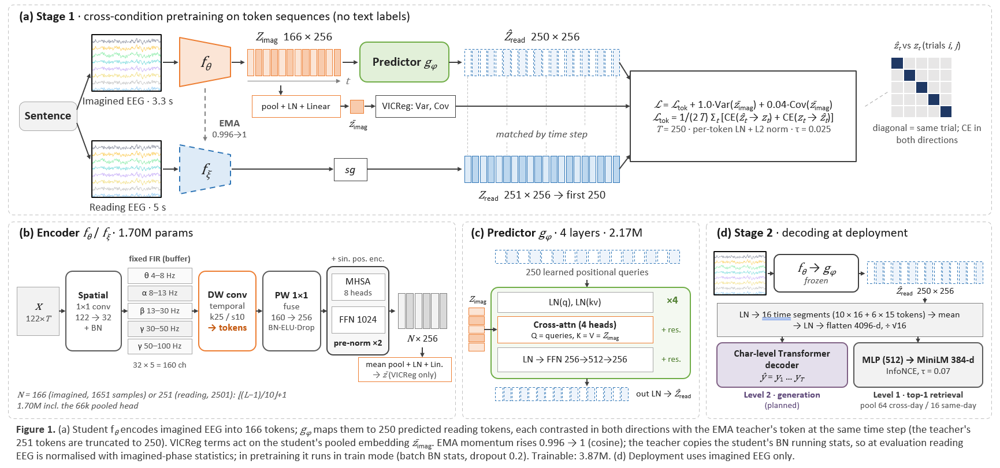

**Master's thesis, Politecnico di Milano (ongoing)**

* Developing **RI-JEPA**, a self-supervised Joint-Embedding Predictive Architecture that uses naturally paired reading-phase and imagined-phase EEG of the same sentence as a privileged cross-condition training signal for decoding Chinese imagined speech from non-invasive EEG.
* Designing an EEG encoder with learnable spatial filtering and multi-band temporal convolutions, pretrained by latent-space prediction with EMA teacher–student training and representation-collapse monitoring.
* Building a controlled evaluation framework on the 5-subject Chisco dataset (OpenNeuro ds005170): comparisons against MAE, contrastive, and single-modality JEPA baselines, shuffled-pair causal controls, data-scaling analysis, and subject-level statistical testing.
* Targeting sentence-level decoding through closed-set retrieval and unseen-sentence generation, with leakage-safe sentence-level data splits.
