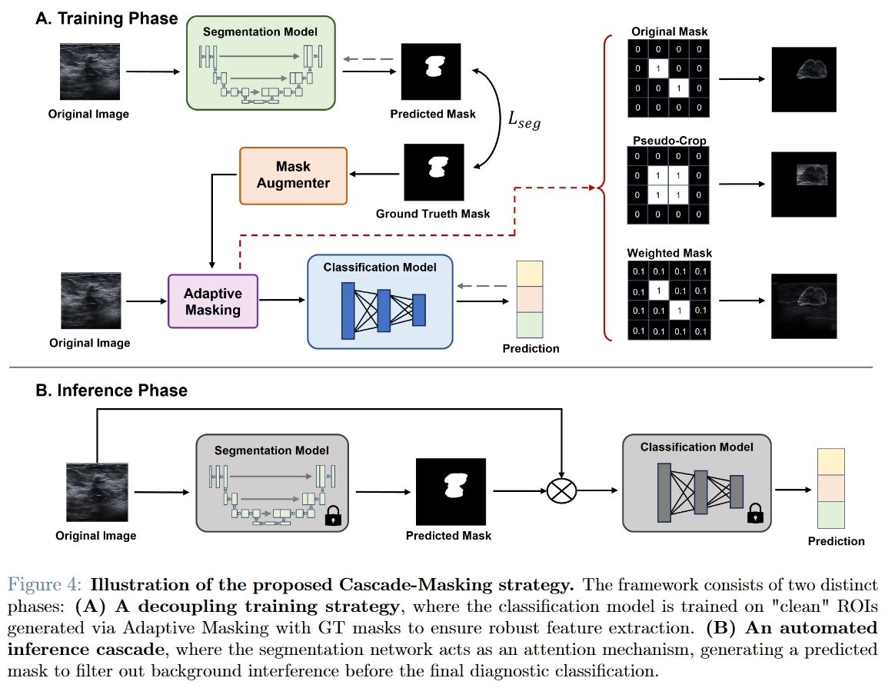

**Team project, Politecnico di Milano (2025)**

* Developed a dual-path diagnosis pipeline combining UNet segmentation with fine-tuned pretrained vision backbones (classification-triggered and segmentation-cascaded classification).
* Systematically compared ROI injection strategies (hard, cropped, and weighted masking) for feeding segmentation output into the classifier.
* Used morphological mask perturbation and multi-seed ablations to reduce cascade error propagation, improving robustness and Macro F1 under uncertain lesion boundaries.
