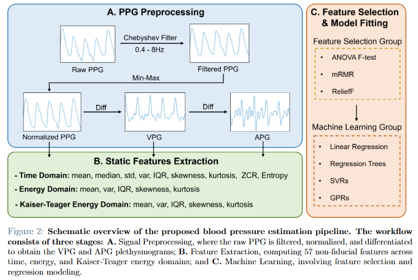

**Team project, Politecnico di Milano (2025)**

* Reproduced a fiducial-point-free, cross-population PPG blood pressure estimation algorithm on MIMIC-BP, a clinical dataset of 1,524 critically ill patients.
* Re-engineered the signal processing pipeline and 57-dimensional feature extraction to fit the new dataset.
* The results contradicted the near-perfect performance reported on the original small, healthy cohort, revealing the method's limited generalization to pathological data under domain shift.
