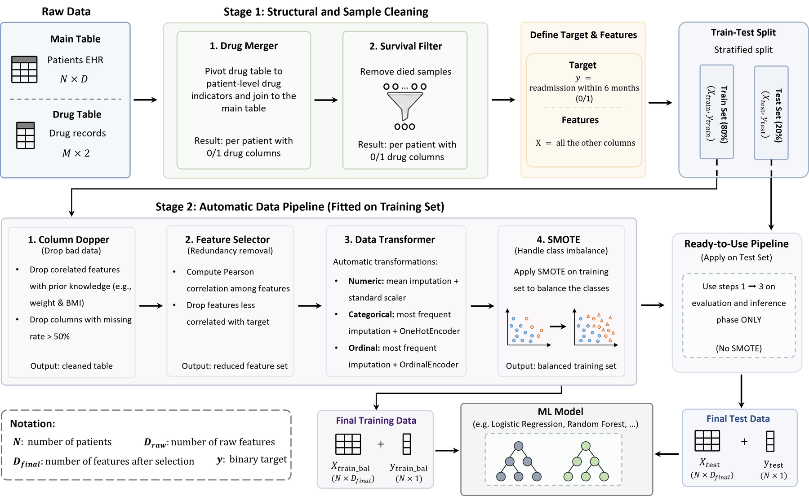

**Team project, Statistical Learning, Politecnico di Milano (2025–2026)**, with Zoe Costard, advised by Prof. Manuela Ferrario

* Predicted **6-month hospital readmission** for discharged heart failure patients as a binary classification task, using an EHR dataset of 2,008 patients with 166 attributes (demographics, clinical characteristics, laboratory findings, comorbidities, and medications).
* Built an end-to-end Scikit-Learn pipeline: survival-based cohort selection, patient-level aggregation of drug records, domain-specific feature engineering (BMI, mean arterial pressure), removal of features with >50% missingness, and correlation-based redundancy removal (20 features dropped).
* Prevented data leakage by splitting before any imputation, fitting all imputation, encoding and scaling on the training set only, and applying SMOTE exclusively to the training data.
* Compared Logistic Regression, Lasso, Decision Tree, Random Forest, SVM, and Gaussian Process classifiers. The grid-search-tuned Random Forest achieved the best accuracy (0.656) and precision (0.587) with an AUC-ROC of 0.679, while Logistic Regression offered the best recall–precision balance among interpretable models.
* Ran an **algorithmic fairness analysis** with Chi-square tests across gender, age, occupation, admission ward, and admission way: performance was consistent across most subgroups, but specificity differed significantly by occupation (p = 0.034), pointing to socioeconomic representation bias in the EHR.
