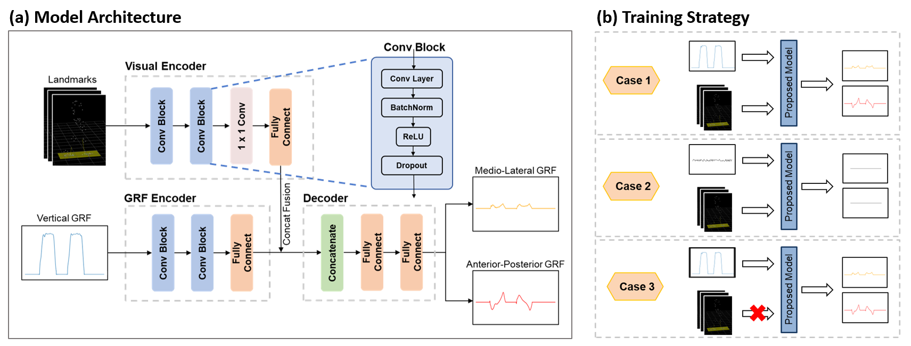

**Team project, Technologies for Sensors and Clinical Instrumentation, Politecnico di Milano (Mar. 2024 – Jun. 2024)**

* Measured vertical ground reaction force (GRF) during adult walking using force-sensitive resistors.
* Designed a deep neural network to estimate anterior-posterior and medial-lateral GRF from the vertical GRF combined with video-based gait analysis.
